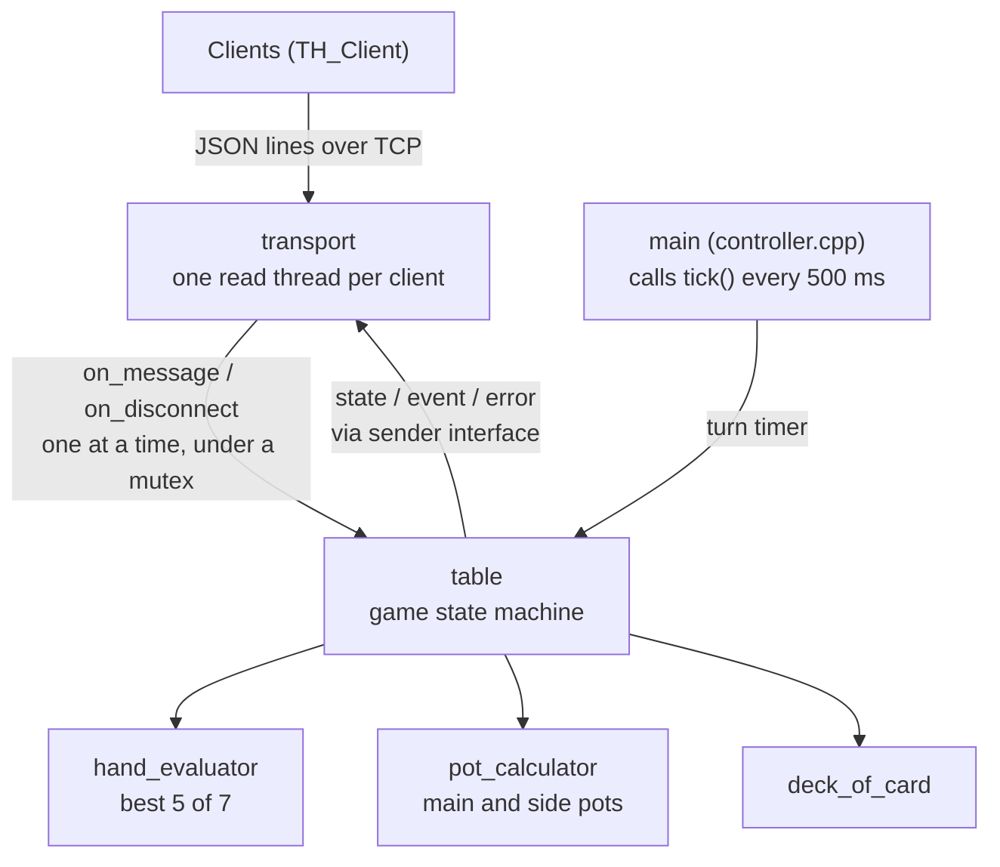

# Texas Hold’em Server 🂡🂮🂱

> **Author:** Bryan  
> **Language:** C++17  
> **Status:** 🛠 Alpha – playable, under refactor  
> **Repos:**  
> • Server (this repo)  
> • Client → https://github.com/Bryan438/TH_Client  


---

## Project Goal
A lightweight, headless Texas Hold’em engine that **accepts socket connections from multiple CLI/GUI clients**, enforces game flow, and sends every player the full game state after each change.

---

## Architecture Overview


---

## Build & Run
```bash
make                      # builds ./thserver
./thserver                # port 4000, 30 s per turn, 200 starting chips, blinds 1/2
./thserver 4000 20 500    # port, seconds per turn (0 = no limit), starting chips
TH_VERBOSE=1 ./thserver   # also print every message sent and received
```
Players connect with the client: https://github.com/Bryan438/TH_Client

## Protocol
Newline-delimited JSON over TCP: one JSON object per line, both directions.
You can even play by hand with `nc localhost 4000`.

Client -> server
```jsonc
{"type":"join","name":"Bryan"}
{"type":"start"}
{"type":"action","action":"fold"}          // also "check", "call"
{"type":"action","action":"raise","amount":20}   // raise TO 20 this round
```

Server -> client
- `welcome` - your seat number
- `state` - the whole table as you may see it, sent to everyone after every change:
  stage, board, pot, current bet, dealer and blinds, every seat's stack / bet / status,
  your own hole cards (everyone's still in the hand at showdown), your best hand,
  whose turn it is and seconds left, and, on your turn, the allowed actions with the raise range
- `event` - a line for the game log ("Bob raises to 20", "Flop: Q♥ 8♥ 4♠")
- `error` - why a message was rejected

Rules handled by the server: turn order, check/call/raise options, minimum raise (a short
all-in does not reopen betting), side pots, heads-up blinds, button rotation. A player who
runs out of time checks if possible, otherwise folds. A player who disconnects folds the
current hand and gets their seat and chips back by joining again with the same name.

## Test
```bash
make test       # builds and runs tests/run_tests with AddressSanitizer + UBSan
```
Tests have no external dependencies (`tests/test_framework.h`). They cover:
- hand ranking (`hand_evaluator.cpp`): every category, kickers, wheel straight, best 5 of 7
- pot splitting (`pot_calculator.cpp`): main pot, multiple side pots, uncalled bets, odd chips
- line framing (`line_buffer.h`, `transport.cpp`) across split / merged TCP reads
- full hands driven through `table::on_message` with a fake clock: state reaching every
  player after every action, private hole cards, minimum raises, all-ins, turn timer,
  disconnect and reconnect, late joiners, busted players

JSON: [nlohmann/json](https://github.com/nlohmann/json) v3.11.3, vendored in `third_party/` (MIT).
