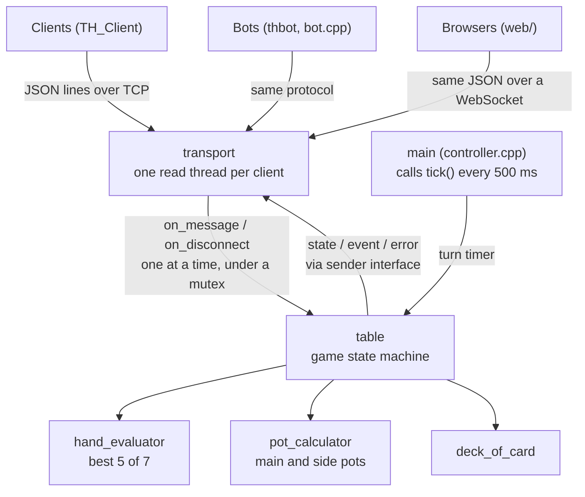

# Texas Hold’em Server 🂡🂮🂱

[](https://github.com/Bryan438/Texas_Holdem_1/actions/workflows/ci.yml)

> **Author:** Bryan  
> **Language:** C++17  
> **Status:** 🛠 Alpha – playable, under refactor  
> **Repos:**  
> • Server, bots and web client (this repo)  
> • Terminal client → https://github.com/Bryan438/TH_Client  


---

## Project Goal
A lightweight Texas Hold’em engine that **accepts connections from terminal clients, browsers and bots at the same table**, enforces game flow, and sends every player the full game state after each change.

---

## Architecture Overview


---

## Build & Run
```bash
make                      # builds ./thserver, ./thstats, ./thbot, ./thmatch and ./thenv
./thserver                # port 4000, 5 min per turn, 200 chips, blinds 1/2; type s to start each hand
                          # then open http://localhost:8080 to play in a browser
./thserver --web-port 9000          # browsers on another port (0 = no web client)
./thserver --port 4000 --turn 60 --chips 500 --next-hand 10
./thserver --turn 0       # no time limit
./thserver --next-hand 10 # optional: start the next hand by itself 10 s after the last one
./thserver --grace 60     # a player who disconnects mid-hand has 60 s to come back (default 30, 0 = folds at once)
./thserver --history game.jsonl     # save hands to game.jsonl (default hands.jsonl)
./thserver --no-history   # do not save hands
./thserver --verbose      # also print every message sent and received
./thserver --help
```
Players sit down from a browser (below), from the terminal client
(https://github.com/Bryan438/TH_Client), or both at the same table.

## Play in a browser
Start `./thserver` and open **http://localhost:8080**. Friends on the same network open
`http://<your ip>:8080`. Type a name, sit down, and press the deal button once two players
have chips; to play against bots, start some in another terminal (`./thbot --bots 3`, see Bots).

- The page shows the table from your seat: everyone's stack, bet and status, the board,
  the pot, your cards and best hand, whose turn it is with the time left, and a hand log.
- On your turn: fold, check or call, or raise with the slider, the number box or the
  min / ½ pot / pot / all-in buttons. Keys: `F` fold, `C` check or call, `R` raise.
- "Review last hand" shows the finished hand street by street.
- English and Chinese; the button in the top right switches, and the choice is remembered.
- Reloading the page or losing the connection takes your seat back by itself (the page keeps
  the token), and the hand log comes back with it. If that happens during a hand, your cards
  wait for you for 30 seconds (`--grace`).
- When everyone else at the table is a bot, two more buttons appear: **End game** stops
  dealing and shows who is up and who is down; **Restart** puts everyone back on the starting
  chips. Either cancels the hand in progress and gives its bets back. With a second person
  at the table the buttons are gone: nobody can end someone else's game.

How it works: the page is plain HTML, CSS and JavaScript in `web/`, no build step and no
libraries. `thserver` serves those files itself on the web port and upgrades `/ws` to a
WebSocket (handshake, frames, SHA-1 and base64 are in `websocket.cpp`, about 300 lines, no
dependencies). Over the WebSocket travel the same JSON messages as over TCP, one per
WebSocket message instead of one per line, so the table does not know or care which kind
of client a player uses. A WebSocket is only accepted from the server's own page: another
website open in your browser cannot sit down at your table.

## Protocol
Newline-delimited JSON over TCP: one JSON object per line, both directions.
You can even play by hand with `nc localhost 4000`. Browsers send and receive the same
objects over a WebSocket (`ws://host:8080/ws`), one per message.

Client -> server
```jsonc
{"type":"join","name":"Bryan"}
{"type":"join","name":"Bryan","token":"..."}   // take your seat back after a disconnect
{"type":"join","name":"Robo","bot":true}       // a program, not a person (thbot says so)
{"type":"start"}
{"type":"action","action":"fold"}          // also "check", "call"
{"type":"action","action":"raise","amount":20}   // raise TO 20 this round
{"type":"end_game"}   // only for a person alone with bots: stop and show the standings
{"type":"new_game"}   // same person, or anyone once the game is over: starting chips again, hand 1 next
```

Server -> client
- `welcome` - your seat number and a secret `token` (keep it to reconnect)
- `state` - the whole table as you may see it, sent to everyone after every change:
  stage, board, pot, current bet, dealer and blinds, every seat's stack / bet / status,
  your own hole cards (everyone's still in the hand at showdown), your best hand,
  whose turn it is and seconds left, seconds until the next hand starts, and, on your turn,
  the allowed actions with the raise range; also which seats are bots, `reconnect_in` for a
  seat whose player dropped out mid-hand, `solo` (you may end or restart the game), and after
  `end_game` `game_over` with `standings` (chips and net per player, best first)
- `event` - a line for the game log: `text` is ready to print ("Bob raises to 20",
  "Flop: Q♥ 8♥ 4♠"); `kind` and fields such as `name`, `amount`, `allin`, `cards`, `hand`
  say the same for clients that word it themselves (the web client, in two languages)
- `error` - why a message was rejected: `message` to print, `code` to word it yourself
  (`not_your_turn`, `name_taken`, `table_full`, ...)
- `hand_summary` - the hand that just ended: actions by street, board, showdown, winners;
  hole cards only for yourself and for hands shown at showdown

Rules handled by the server: turn order, check/call/raise options, minimum raise (a short
all-in does not reopen betting), side pots, heads-up blinds, button rotation. A player who
runs out of time checks if possible, otherwise folds. A player who disconnects during a hand
keeps their cards for 30 seconds (`--grace`; the turn timer still runs) and plays on if they
are back by then, otherwise folds; a player who is all-in stays in the hand. They get their
seat and chips back by joining again with the same name and their token; without the token
nobody else can take that seat. A hand that is cancelled by `end_game` or `new_game` returns
every bet and is not written to the history; after `end_game` nothing is dealt until a new
game (a `start` from a person begins one). Each hand starts when a player
sends `start`; with `--next-hand N` the next one starts by itself after N seconds instead.

## Hand history and stats
Every finished hand is appended to `hands.jsonl`, one JSON object per line: start stacks,
every player's hole cards, blinds and actions with the street and chips put in (plus
`reason` for timeouts and disconnects), board, showdown, winners, and each player's net.
**The file contains everyone's cards**: it stays on the server and is never sent to players.

```bash
./thstats                 # reads hands.jsonl
./thstats game.jsonl
```
```
Player            Hands      Net   VPIP    PFR    Won  Showdowns     Best
Bob                   2      +11     0%     0%    50%        1/1       24
Alice                 2      -11    50%     0%    50%        0/1        3
```
VPIP: put money in preflop by choice (blinds don't count). PFR: raised preflop.
`thstats` also checks that every hand adds up (chips in = pot = chips out) and warns if not.

## Bots
A bot is a normal player: `thbot` connects over TCP, joins with a name and plays with the
same JSON messages as the client. It decides only from the `state` it is sent, so it sees
what a person in its seat would see, no more. The server does not need to know about bots.

```bash
./thbot                                   # one bot named Robo joins 127.0.0.1:4000
./thbot 192.168.1.20 4000 --bots 3        # Robo1, Robo2, Robo3
./thbot --name Station --style calling --delay 0.5
./thbot --style rules                     # default style: equity
./thbot --style rl                        # the learned bot (see below)
./thbot --bots 3 --start                  # bots-only table: a bot starts each hand
```
By default a bot never starts a hand, so a person still types `s`. With `--start`, the
first bot starts the next hand a few seconds after the last one ends.

Styles (`bot.cpp`):
- `random` - any legal move; a baseline
- `calling` - always checks or calls, never folds or raises (a "calling station")
- `rules` - preflop: the [Chen formula](https://en.wikipedia.org/wiki/Texas_hold_%27em_starting_hands)
  scores the two hole cards; strong hands raise, middling ones call small raises, the rest fold.
  After the flop: reads its hand (set or better, top pair / overpair, a weaker pair, a flush
  or straight draw with its outs, or nothing). It bets strong hands, calls when the pot odds
  are good enough (rule of 4 and 2 for draws), semi-bluffs some draws, bluffs a little
  heads-up, and folds the rest.
- `equity` - estimates its chance of winning (its *equity*) by Monte Carlo simulation
  (`equity.cpp`): deal the unseen cards at random 1,000 times and count how often it wins,
  splitting ties. It compares that with the price of calling (call / (pot + call)), and bets
  or raises when it is well ahead of an average hand. Preflop equities are worked out once
  per kind of hand (AKs, 72o, ...) and number of opponents, then looked up.
  - **Opponent ranges.** Assuming opponents hold random cards made it call far too often:
    people rarely bet with nothing. When facing a bet after the flop, it only deals opponents
    hands that connect with the board (a pair or better using a hole card, or a flush draw),
    and for bets of half the pot or more, only top pair or better, or a flush draw. This
    took it from losing to `rules` (-26 ± 24 bb/100) to beating it.
  - **Speed.** Simulations score millions of hands, so `evaluate_fast` scores 7 cards in one
    pass (rank counts and suit bit masks) instead of trying all 21 five-card hands. It is 13x
    faster and the tests check it gives the same score as `evaluate_best`.

- `rl` - a small neural network that learned by playing the four styles above; nobody wrote
  its rules. See [A bot that learns](#a-bot-that-learns).

### How strong is each bot?
`thmatch` seats bots on a real table in one process (no network) and plays many hands.
Every bot starts every hand at 100 big blinds, so nobody busts and each hand counts the same.
The same `--seed` gives the same cards and the same result.

```bash
./thmatch --hands 10000 rules calling
./thmatch --hands 5000 rules rules calling random --history bots.jsonl   # then ./thstats bots.jsonl
```
Heads-up (big blinds won per 100 hands, 95% confidence interval):

| Match | Hands | Winner | bb/100 |
|---|---|---|---|
| equity vs rules | 20,000 | equity | +9.4 ± 7.1 (seeds 2 and 3: +8.5 ± 7.6, +14.8 ± 7.6) |
| equity vs calling | 10,000 | equity | +235.9 ± 17.2 |
| equity vs random | 10,000 | equity | +156.2 ± 26.9 |
| rules vs calling | 10,000 | rules | +105.7 ± 10.4 |
| rules vs random | 10,000 | rules | +85.3 ± 19.9 |
| calling vs random | 10,000 | too close to tell | 7.0 ± 62.7 |

Six players, 10,000 hands: the two `equity` bots won +591 and +563 bb/100, the two `rules`
bots +336 and +263; `random` lost 489 and `calling` 1264. Against `rules` the margin is small:
both play tight and both mostly bet good hands, so the next step would be bots that adapt to
how each opponent plays (or learn it, see the hand history).

### A bot that learns
The `rl` style was trained with reinforcement learning (PPO): it played millions of
decisions against the other styles and was nudged towards the choices that won chips.

- **What it sees** (`rl_policy.cpp`): 37 numbers describing the spot. Its chance of winning
  against any hand and against a bettor's likely hands (the same simulation the equity bot
  uses), the price of calling, pot and stack sizes, position, its hole cards, what they make
  with the board, and the board's texture. Like every bot it only knows what a person in
  its seat would know.
- **What it can do**: fold, check or call, bet or raise half the pot, bet or raise the pot,
  or go all in. Moves that make no sense in a spot (folding when checking is free) are not
  offered.
- **The network**: two hidden layers of 64 neurons. It scores the five moves and picks one
  at random in proportion, so it does not always play the same hand the same way.
- **Training** (`rl/train.py`, adapted from [CleanRL](https://github.com/vwxyzjn/cleanrl)'s
  `ppo.py`, MIT): `thenv` runs real tables with the learner in seat 0 and the other styles
  in the rest, and talks to the Python trainer over a pipe. The reward is the big blinds won
  when a hand ends. The built-in network took 6 million decisions in two runs (below),
  about fifteen minutes on a laptop.
- **Playing**: the trained network is built into `thbot` and `thmatch`
  (`rl_model_data.cpp`); C++ runs it directly, so playing needs no Python.

```bash
cd rl
python3 -m venv .venv && .venv/bin/pip install -r requirements.txt
# Run 1: every style, tables of 2 to 6 players -> models/rl.txt and models/rl.pt
.venv/bin/python train.py --opponents equity:5,rules:2,calling:2,random:1 --players 2,2,2,2,3,3,4,6
../thmatch --model models/rl.txt --hands 20000 rl equity  # how good is it so far?
# Run 2: train on, mostly against equity, then build the result into thbot and thmatch
.venv/bin/python train.py --start-from models/rl.pt --learning-rate 2e-4 --embed \
    --opponents equity:14,rules:4,calling:1,random:1 --players 2,2,2,2,2,3,4,6
cd .. && make
```
`train.py --help` lists the options: which styles to train against and how often
(`--opponents equity:14,rules:4,calling:1,random:1`), table sizes (`--players 2,2,3,6`),
and the PPO settings.

Heads-up results of the built-in network (bb/100, 95% confidence interval):

| Match | Hands | bb/100 for rl |
|---|---|---|
| rl vs equity | 50,000 | +44.3 ± 8.2 (seed 2: +44.8 ± 8.4) |
| rl vs rules | 30,000 | +44.1 ± 7.1 |
| rl vs calling | 10,000 | +2293.9 ± 123.8 |
| rl vs random | 10,000 | +784.3 ± 74.6 |

Four players (rl, equity, rules, calling; 10,000 hands): rl +2089, equity +332, rules +140,
calling -2561.

What these numbers do and do not say. The network learned to beat *these four bots*, and it
found their habits: `equity` and `rules` fold too often to bets, so it bets a lot (heads-up
it plays 80% of hands and raises 65% before the flop), and `calling` never folds, so it puts
all its chips in with good hands. The mix of opponents matters: trained on a mix with many
weak opponents it crushed them but only broke even with `equity` (-8 ± 19); trained on
`equity` alone it lost to `calling`. It has not been measured against people, it does not
remember how an opponent played earlier hands, and a player who sees through its betting
could beat it. Natural next steps: train it against earlier versions of itself, and give
it each opponent's statistics from the hand history.

## Test
```bash
make test       # builds and runs tests/run_tests with AddressSanitizer + UBSan
make test-web   # the web client's logic and translations (needs Node 18+, nothing to install)
```
GitHub Actions runs the build and both sets of tests on Linux and macOS for every push and
pull request, and checks that a freshly started server hands out the web page.

Tests have no external dependencies (`tests/test_framework.h`). They cover:
- hand ranking (`hand_evaluator.cpp`): every category, kickers, wheel straight, best 5 of 7
- pot splitting (`pot_calculator.cpp`): main pot, multiple side pots, uncalled bets, odd chips
- line framing (`line_buffer.h`, `transport.cpp`) across split / merged TCP reads
- browsers (`websocket.cpp`, `transport.cpp`): SHA-1 and base64 against known answers, the
  handshake, frames of every length, messages split over frames or reads, what a browser
  never sends, a whole WebSocket connection from handshake to close, web files served and
  paths outside `web/` refused, WebSockets from other sites refused
- the fields of `event` and `error` messages
- coming back after a disconnect: cards kept, the hand played on, folded when the time is up,
  all-in players left in, the turn timer still applied
- ending and restarting a game: only for a person alone with bots, the hand cancelled with
  every chip returned and nothing written to the history, standings, nothing dealt after the end
- the web client (`web/tests`, run by Node): seat and chip positions, raise sizes, the
  last-hand review, every string present in both languages with the same placeholders
- full hands driven through `table::on_message` with a fake clock: state reaching every
  player after every action, private hole cards, minimum raises, all-ins, turn timer,
  disconnect and reconnect (with and without the token), the next-hand countdown,
  late joiners, busted players
- hand history: what is recorded, what each player is sent, the history file, stats, and
  40 hands of random folds / calls / raises / all-ins that must all add up
- bots: card codes, Chen scores, hand reading (made hands, draws and outs), the moves the
  rules and equity bots pick in set spots, raises kept inside the allowed range, whole matches
  where every move must be legal and every hand add up, same seed same result, and both bots
  beating the baselines
- the learned bot: the numbers it sees in set spots, only sensible moves offered, every choice
  turned into a legal move, model files read and bad ones refused with a reason, training
  tables that play legal hands and repeat with the same seed, and the built-in network
  beating the baselines
- equity: known all-in odds (AA 85%, 72o 35%), split pots and kickers, the nuts, opponent
  ranges, the preflop table, and `evaluate_fast` agreeing with `evaluate_best` on 100,000
  random hands

JSON: [nlohmann/json](https://github.com/nlohmann/json) v3.11.3, vendored in `third_party/` (MIT).
