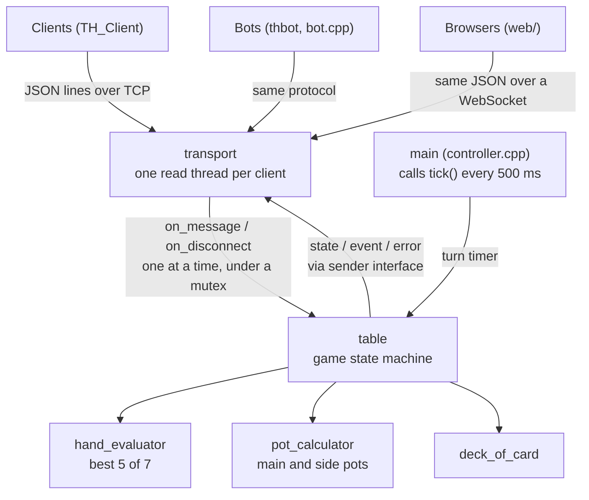

# Texas Hold’em Server 🂡🂮🂱

[](https://github.com/Bryan438/Texas_Holdem_1/actions/workflows/ci.yml)

> **Author:** Bryan  
> **Language:** C++17  
> **Status:** 🛠 Alpha – playable, under refactor  
> **Repos:**  
> • Server, bots and web client (this repo)  
> • Terminal client → https://github.com/Bryan438/TH_Client  


---

## Project Goal
A lightweight Texas Hold’em engine that **accepts connections from terminal clients, browsers and bots at the same table**, enforces game flow, and sends every player the full game state after each change.

---

## Architecture Overview


---

## Build & Run
```bash
make                      # builds ./thserver, ./thstats, ./thbot, ./thmatch and ./thenv
./thserver                # port 4000, 5 min per turn, 200 chips, blinds 1/2; type s to start each hand
                          # then open http://localhost:8080 to play in a browser
./thserver --web-port 9000          # browsers on another port (0 = no web client)
./thserver --port 4000 --turn 60 --chips 500 --next-hand 10
./thserver --turn 0       # no time limit
./thserver --next-hand 10 # optional: start the next hand by itself 10 s after the last one
./thserver --bot-delay 2  # bots added from the web page think 2 s before each move (default 1)
./thserver --grace 60     # a player who disconnects mid-hand has 60 s to come back (default 30, 0 = folds at once)
./thserver --history game.jsonl     # save hands to game.jsonl (default hands.jsonl)
./thserver --no-history   # do not save hands
./thserver --verbose      # also print every message sent and received
./thserver --help
```
On the internet, behind a reverse proxy with HTTPS: [deploy/README.md](deploy/README.md)
(one script sets up a fresh Ubuntu server). The options it uses: `--bind` / `--web-bind`
(listen on one address only), `--trust-proxy` (count browsers by the address the proxy
reports), `--max-connections` / `--max-per-ip` (default 200 / 20), `--console-fifo PATH`
(console commands through a named pipe, for a server with no terminal).

While the server runs you can type into its terminal:
```
tables           the tables that are open: blinds, chips, who is seated, host, private or not
players          who is seated at each table: chips, person or bot, here / disconnected / leaving
kick NAME        remove someone from their table (a running hand is folded for them);
kick NAME 3      ...at table 3, when the name sits at more than one table
help
```
A server started without a terminal (input from `/dev/null`) simply has no console.

Players sit down from a browser (below), from the terminal client
(https://github.com/Bryan438/TH_Client), or both at the same table.

## Play in a browser
Start `./thserver` and open **http://localhost:8080**. Friends on the same network open
`http://<your ip>:8080`. Type a name and pick a table from the lobby, or open your own; then
press **Add bots** to seat some opponents, and deal. Bots added from the page are played by
the server itself: there is nothing else to start. (Bots in another terminal,
`./thbot --bots 3`, still work as before; see Bots.)

- **The lobby** lists every table: its name, blinds, starting chips, how many are seated,
  whether a hand is running, the host, and whether it needs a password. The main table is
  always there; **Open a new table** picks a name, blinds (1/2, 2/5 or 5/10), starting chips
  (50, 100 or 200 big blinds) and, if you like, a password. Whoever opens a table sits down
  as its host. At most 20 tables are open at once; a table with nobody at it closes after
  10 minutes (the main table never does).
- You sit at one table at a time. **Leave** brings you back to the lobby; your chips at that
  table are kept for you as usual. A reload sits you down at the same table again.

- The page shows the table from your seat: everyone's stack, bet and status, the board,
  the pot, your cards and best hand, whose turn it is with the time left, and a hand log.
- On your turn: fold, check or call, or raise with the slider, the number box or the
  min / ½ pot / pot / all-in buttons. Keys: `F` fold, `C` check or call, `R` raise.
- "Review last hand" shows the finished hand street by street.
- **The host** is the first person to sit down (marked on their seat). Only the host deals,
  adds bots, and sends someone away with the × on their seat (a bot at once, a person after
  a question; a person in a hand folds). When the host leaves, or is away longer than the
  grace period, the next person in seat order takes over. With only bots at the table,
  anyone may deal.
- **Add bots** (the host): pick a style (rl, equity, rules, calling, random) and how many.
  They join like anyone else, from the next hand if one is running, and wait a second
  before each move (`--bot-delay`).
- English and Chinese; the button in the top right switches, and the choice is remembered.
- Reloading the page or losing the connection takes your seat back by itself (the page keeps
  the token), and the hand log comes back with it. If that happens during a hand, your cards
  wait for you for 30 seconds (`--grace`).
- **End game** stops dealing and shows who is up and who is down; **Restart** puts everyone
  back on the starting chips. Either cancels the hand in progress and gives its bets back.
  When everyone else at the table is a bot it happens at once. With other people at the
  table it is a vote: a bar shows who asked and who still has to answer, and it happens
  once every connected person agrees within 60 seconds. One "no", or the time running out,
  drops it. People who leave or are disconnected do not hold a vote up.
- **Leave** gets up from the table: a hand you are in is folded (all-in, you stay in for
  the showdown) and the seat goes once the hand is over. The chips are kept for this game:
  sitting down again with the same name from the same browser brings them back, and nobody
  else can take that name. The results count people who left, with what they took.
- **Buy in again**: a player out of chips gets the button. It adds the starting chips and
  counts them as put in, so the results stay honest (a new name is a new buy-in too).

How it works: the page is plain HTML, CSS and JavaScript in `web/`, no build step and no
libraries. `thserver` serves those files itself on the web port and upgrades `/ws` to a
WebSocket (handshake, frames, SHA-1 and base64 are in `websocket.cpp`, about 300 lines, no
dependencies). Over the WebSocket travel the same JSON messages as over TCP, one per
WebSocket message instead of one per line, so the table does not know or care which kind
of client a player uses. A WebSocket is only accepted from the server's own page: another
website open in your browser cannot sit down at your table.

## Protocol
Newline-delimited JSON over TCP: one JSON object per line, both directions.
You can even play by hand with `nc localhost 4000`. Browsers send and receive the same
objects over a WebSocket (`ws://host:8080/ws`), one per message.

The server is a lobby with several tables. A connection starts in the lobby and gets the
list of tables (`lobby`); at a table everything works as on a server with one table.

Lobby (client -> server)
```jsonc
{"type":"list_tables"}
{"type":"create_table","name":"Friday","blinds":[2,5],"chips":500,"password":"..."}
    // blinds 1/2, 2/5 or 5/10; chips 20-500 big blinds (default 100); password optional
    // answer: {"type":"table_created","table":3}; then join it
{"type":"join","table":3,"name":"Bryan","password":"..."}   // sit down at table 3
```
`join` without `table` sits at the main table (table 1), so clients written before the lobby,
and `thbot`, work unchanged. Server -> client: `{"type":"lobby","tables":[{"id","name","main",
"private","blinds","chips","seats","people","max","playing","host"}],"max_tables","can_create"}`,
on connecting, on getting up from a table, and whenever the list changes. Errors: `no_table`,
`bad_password`, `lobby_full`, `table_name`, `bad_blinds`, `bad_chips`, `at_table`. A table that
closes under a bot still sitting there sends it `left` with `reason: closed`.

At a table (client -> server)
```jsonc
{"type":"join","name":"Bryan"}
{"type":"join","name":"Bryan","token":"..."}   // take your seat back after a disconnect
{"type":"join","name":"Robo","bot":true}       // a program, not a person (thbot says so)
{"type":"start"}
{"type":"action","action":"fold"}          // also "check", "call"
{"type":"action","action":"raise","amount":20}   // raise TO 20 this round
{"type":"end_game"}   // stop and show the standings: alone with bots at once, otherwise a vote
{"type":"new_game"}   // starting chips again, hand 1 next: same rule, no vote once the game is over
{"type":"vote","agree":true}   // answer the open vote; every connected person must agree, one false drops it
{"type":"leave"}      // get up: fold now if in a hand, the seat goes when it is over;
                      // joining again with the same name and token brings the chips back
{"type":"rebuy"}      // out of chips: the starting chips again, counted as bought in
{"type":"add_bot","style":"rl","count":2}   // the host seats bots that the server plays itself
{"type":"remove_bot","seat":3}              // the host, between hands: one of those bots goes
{"type":"kick","seat":2}                    // the host sends someone away
```

Server -> client
- `welcome` - your seat number and a secret `token` (keep it to reconnect; a token belongs to
  one table)
- `state` - the whole table as you may see it, sent to everyone after every change:
  stage, board, pot, current bet, dealer and blinds, every seat's stack / bet / status,
  your own hole cards (everyone's still in the hand at showdown), your best hand,
  whose turn it is and seconds left, seconds until the next hand starts, and, on your turn,
  the allowed actions with the raise range; also which seats are bots, `reconnect_in` for a
  seat whose player dropped out mid-hand, `solo` (ending or restarting needs nobody else),
  `vote` (`kind` end or new, `by`, `agreed`, `waiting`, `seconds_left`; null when none),
  `host` (the host's seat, -1 for none; only the host may `start`, add or remove bots and
  `kick`), `starting_chips`, a seat's `rebuys`,
  and after `end_game` `game_over` with `standings` (chips and net per player, best first;
  people who left during the game are in it with `left: true`)
- `event` - a line for the game log: `text` is ready to print ("Bob raises to 20",
  "Flop: Q♥ 8♥ 4♠"); `kind` and fields such as `name`, `amount`, `allin`, `cards`, `hand`
  say the same for clients that word it themselves (the web client, in two languages)
- `error` - why a message was rejected: `message` to print, `code` to word it yourself
  (`not_your_turn`, `name_taken`, `table_full`, ...)
- `hand_summary` - the hand that just ended: actions by street, board, showdown, winners;
  hole cards only for yourself and for hands shown at showdown
- `left` - you are no longer seated (`reason`: `left`, or `kicked` by the server); join
  again to play

Rules handled by the server: turn order, check/call/raise options, minimum raise (a short
all-in does not reopen betting), side pots, heads-up blinds, button rotation. A bet that
nobody calls goes back to the bettor before the pot is paid, so "wins N" is the pot itself. A player who
runs out of time checks if possible, otherwise folds. A player who disconnects during a hand
keeps their cards for 30 seconds (`--grace`; the turn timer still runs) and plays on if they
are back by then, otherwise folds; a player who is all-in stays in the hand. They get their
seat and chips back by joining again with the same name and their token; without the token
nobody else can take that seat. A hand that is cancelled by `end_game` or `new_game` returns
every bet and is not written to the history; after `end_game` nothing is dealt until a new
game (a `start` from a person begins one). Each hand starts when a player
sends `start`; with `--next-hand N` the next one starts by itself after N seconds instead.

## Hand history and stats
Every finished hand is appended to `hands.jsonl`, one JSON object per line: start stacks,
every player's hole cards, blinds and actions with the street and chips put in (plus
`reason` for timeouts and disconnects), board, showdown, the pot, any uncalled bet that was
`returned`, winners, and each player's net.
**The file contains everyone's cards**: it stays on the server and is never sent to players.

```bash
./thstats                 # reads hands.jsonl
./thstats game.jsonl
```
```
Player            Hands      Net   VPIP    PFR    Won  Showdowns     Best
Bob                   2      +11     0%     0%    50%        1/1       24
Alice                 2      -11    50%     0%    50%        0/1        3
```
VPIP: put money in preflop by choice (blinds don't count). PFR: raised preflop.
`thstats` also checks that every hand adds up (chips in = pot = chips out) and warns if not.

## Bots
A bot is a normal player: `thbot` connects over TCP, joins with a name and plays with the
same JSON messages as the client. It decides only from the `state` it is sent, so it sees
what a person in its seat would see, no more. The server does not need to know about bots.

```bash
./thbot                                   # one bot named Robo joins 127.0.0.1:4000
./thbot 192.168.1.20 4000 --bots 3        # Robo1, Robo2, Robo3
./thbot --name Station --style calling --delay 0.5
./thbot --style rules                     # default style: equity
./thbot --style rl                        # the learned bot (see below)
./thbot --table 3 --password owl         # sit at table 3 of the lobby (default: the main table)
./thbot --bots 3 --start                  # bots-only table: a bot starts each hand
```
By default a bot never starts a hand, so a person still types `s`. With `--start`, the
first bot starts the next hand a few seconds after the last one ends.

Styles (`bot.cpp`):
- `random` - any legal move; a baseline
- `calling` - always checks or calls, never folds or raises (a "calling station")
- `rules` - preflop: the [Chen formula](https://en.wikipedia.org/wiki/Texas_hold_%27em_starting_hands)
  scores the two hole cards; strong hands raise, middling ones call small raises, the rest fold.
  After the flop: reads its hand (set or better, top pair / overpair, a weaker pair, a flush
  or straight draw with its outs, or nothing). It bets strong hands, calls when the pot odds
  are good enough (rule of 4 and 2 for draws), semi-bluffs some draws, bluffs a little
  heads-up, and folds the rest.
- `equity` - estimates its chance of winning (its *equity*) by Monte Carlo simulation
  (`equity.cpp`): deal the unseen cards at random 1,000 times and count how often it wins,
  splitting ties. It compares that with the price of calling (call / (pot + call)), and bets
  or raises when it is well ahead of an average hand. Preflop equities are worked out once
  per kind of hand (AKs, 72o, ...) and number of opponents, then looked up.
  - **Opponent ranges.** Assuming opponents hold random cards made it call far too often:
    people rarely bet with nothing. When facing a bet after the flop, it only deals opponents
    hands that connect with the board (a pair or better using a hole card, or a flush draw),
    and for bets of half the pot or more, only top pair or better, or a flush draw. This
    took it from losing to `rules` (-26 ± 24 bb/100) to beating it.
  - **Speed.** Simulations score millions of hands, so `evaluate_fast` scores 7 cards in one
    pass (rank counts and suit bit masks) instead of trying all 21 five-card hands. It is 13x
    faster and the tests check it gives the same score as `evaluate_best`.

- `rl` - a small neural network that learned by playing the four styles above; nobody wrote
  its rules. See [A bot that learns](#a-bot-that-learns).

### How strong is each bot?
`thmatch` seats bots on a real table in one process (no network) and plays many hands.
Every bot starts every hand at 100 big blinds, so nobody busts and each hand counts the same.
The same `--seed` gives the same cards and the same result.

```bash
./thmatch --hands 10000 rules calling
./thmatch --hands 5000 rules rules calling random --history bots.jsonl   # then ./thstats bots.jsonl
```
Heads-up (big blinds won per 100 hands, 95% confidence interval):

| Match | Hands | Winner | bb/100 |
|---|---|---|---|
| equity vs rules | 20,000 | equity | +9.4 ± 7.1 (seeds 2 and 3: +8.5 ± 7.6, +14.8 ± 7.6) |
| equity vs calling | 10,000 | equity | +235.9 ± 17.2 |
| equity vs random | 10,000 | equity | +156.2 ± 26.9 |
| rules vs calling | 10,000 | rules | +105.7 ± 10.4 |
| rules vs random | 10,000 | rules | +85.3 ± 19.9 |
| calling vs random | 10,000 | too close to tell | 7.0 ± 62.7 |

Six players, 10,000 hands: the two `equity` bots won +591 and +563 bb/100, the two `rules`
bots +336 and +263; `random` lost 489 and `calling` 1264. Against `rules` the margin is small:
both play tight and both mostly bet good hands, so the next step would be bots that adapt to
how each opponent plays (or learn it, see the hand history).

### A bot that learns
The `rl` style was trained with reinforcement learning (PPO): it played millions of
decisions against the other styles and was nudged towards the choices that won chips.

- **What it sees** (`rl_policy.cpp`): 37 numbers describing the spot. Its chance of winning
  against any hand and against a bettor's likely hands (the same simulation the equity bot
  uses), the price of calling, pot and stack sizes, position, its hole cards, what they make
  with the board, and the board's texture. Like every bot it only knows what a person in
  its seat would know.
- **What it can do**: fold, check or call, bet or raise half the pot, bet or raise the pot,
  or go all in. Moves that make no sense in a spot (folding when checking is free) are not
  offered.
- **The network**: two hidden layers of 64 neurons. It scores the five moves and picks one
  at random in proportion, so it does not always play the same hand the same way.
- **Training** (`rl/train.py`, adapted from [CleanRL](https://github.com/vwxyzjn/cleanrl)'s
  `ppo.py`, MIT): `thenv` runs real tables with the learner in seat 0 and the other styles
  in the rest, and talks to the Python trainer over a pipe. The reward is the big blinds won
  when a hand ends. The built-in network took 6 million decisions in two runs (below),
  about fifteen minutes on a laptop.
- **Playing**: the trained network is built into `thbot` and `thmatch`
  (`rl_model_data.cpp`); C++ runs it directly, so playing needs no Python.

```bash
cd rl
python3 -m venv .venv && .venv/bin/pip install -r requirements.txt
# Run 1: every style, tables of 2 to 6 players -> models/rl.txt and models/rl.pt
.venv/bin/python train.py --opponents equity:5,rules:2,calling:2,random:1 --players 2,2,2,2,3,3,4,6
../thmatch --model models/rl.txt --hands 20000 rl equity  # how good is it so far?
# Run 2: train on, mostly against equity, then build the result into thbot and thmatch
.venv/bin/python train.py --start-from models/rl.pt --learning-rate 2e-4 --embed \
    --opponents equity:14,rules:4,calling:1,random:1 --players 2,2,2,2,2,3,4,6
cd .. && make
```
`train.py --help` lists the options: which styles to train against and how often
(`--opponents equity:14,rules:4,calling:1,random:1`), table sizes (`--players 2,2,3,6`),
and the PPO settings.

Heads-up results of the built-in network (bb/100, 95% confidence interval):

| Match | Hands | bb/100 for rl |
|---|---|---|
| rl vs equity | 50,000 | +44.3 ± 8.2 (seed 2: +44.8 ± 8.4) |
| rl vs rules | 30,000 | +44.1 ± 7.1 |
| rl vs calling | 10,000 | +2293.9 ± 123.8 |
| rl vs random | 10,000 | +784.3 ± 74.6 |

Four players (rl, equity, rules, calling; 10,000 hands): rl +2089, equity +332, rules +140,
calling -2561.

What these numbers do and do not say. The network learned to beat *these four bots*, and it
found their habits: `equity` and `rules` fold too often to bets, so it bets a lot (heads-up
it plays 80% of hands and raises 65% before the flop), and `calling` never folds, so it puts
all its chips in with good hands. The mix of opponents matters: trained on a mix with many
weak opponents it crushed them but only broke even with `equity` (-8 ± 19); trained on
`equity` alone it lost to `calling`. It has not been measured against people, it does not
remember how an opponent played earlier hands, and a player who sees through its betting
could beat it.

#### Self-play, and how exploitable a network is

`train.py --self-play` also seats earlier versions of the learner: every `--snapshot-every`
updates the network is saved to `rl/models/pool/`, and "rl" opponents draw one of the
latest `--pool-size` versions (plus any `--pool-anchor` networks) for each hand. `thmatch`
can seat a given network with `rl=FILE`, so versions can play each other:

```bash
cd rl
.venv/bin/python train.py --self-play --start-from models/mix2.pt --pool-anchor models/mix2.txt \
    --opponents equity:4,rules:2,calling:1,random:1,rl:8 --players 2,2,2,2,2,3,4,6 \
    --total-timesteps 12000000 --learning-rate 2e-4 --out models/sp
cd .. && ./thmatch --hands 50000 rl=rl/models/sp.txt rl=rl/models/mix2.txt
```

Beating the bots it trained against says little about how a strong player would do. A
better test: train a fresh network heads-up against only the one being tested
(`--opponents rl:1 --opponent-model FILE`, 2 million decisions) and see how much it wins.
The less such an *exploiter* wins, the harder the network is to take advantage of.

Two runs, 12 million decisions each, so far gave no network that is better on every count,
so the built-in one was left as it was:

- **self-play (sp)**: from the built-in network, against the fixed bots and its own recent
  versions (about 35 minutes).
- **league (lg1)**: from the built-in network again, with the self-play network and the two
  exploiters (of the built-in and of sp) added to the pool, the exploiters drawn twice as
  often (about an hour: more network opponents make the tables slower).

| Heads-up, bb/100 (95% interval) | built-in (mix2) | self-play (sp) | league (lg1) |
|---|---|---|---|
| vs the built-in, 50,000 hands | | +134.5 ± 13.3 | -64.3 ± 21.1 |
| vs equity, 30,000 hands | +46.2 ± 10.6 | +15.7 ± 11.1 | -56.0 ± 16.4 |
| vs rules, 30,000 hands | +44.1 ± 7.1 | +17.2 ± 9.8 | -36.4 ± 14.8 |
| vs calling, 10,000 hands | +2293.9 ± 123.8 | +2128.9 ± 118.6 | +1790.5 ± 98.8 |
| what its own exploiter wins from it, 50,000 hands | 628 ± 20 | 1108 ± 36 | 271 ± 34 |

- **sp** beats the built-in network clearly but the fixed bots by less, and is *easier* to
  exploit. Its exploiter raises nearly every hand and keeps betting: sp calls before and on
  the flop, then folds on the turn or river, after paying.
- **lg1** learned to beat those exploiters (it wins 1800 to 2400 bb/100 from them) and its
  own exploiter wins less than half of what the built-in one gives away. But it now loses
  to `equity` and `rules`: braced for opponents who raise every hand, it pays off the ones
  who bet only with good cards.

A network that does not know who it is playing has to pick one way to play against
everyone, and these opponents want opposite things (call the maniac down, fold to the
tight player). The likely way out is to let it see each opponent's statistics (how often
they put money in and raise), so it can tell them apart. Until then the built-in network,
which beats every fixed bot by the most, stays.

## Test
```bash
make test       # builds and runs tests/run_tests with AddressSanitizer + UBSan
make test-web   # the web client's logic and translations (needs Node 18+, nothing to install)
```
GitHub Actions runs the build and both sets of tests on Linux and macOS for every push and
pull request, and checks that a freshly started server hands out the web page.

Tests have no external dependencies (`tests/test_framework.h`). They cover:
- hand ranking (`hand_evaluator.cpp`): every category, kickers, wheel straight, best 5 of 7
- pot splitting (`pot_calculator.cpp`): main pot, multiple side pots, uncalled bets, odd chips
- line framing (`line_buffer.h`, `transport.cpp`) across split / merged TCP reads
- browsers (`websocket.cpp`, `transport.cpp`): SHA-1 and base64 against known answers, the
  handshake, frames of every length, messages split over frames or reads, what a browser
  never sends, a whole WebSocket connection from handshake to close, web files served and
  paths outside `web/` refused, WebSockets from other sites refused
- the fields of `event` and `error` messages
- coming back after a disconnect: cards kept, the hand played on, folded when the time is up,
  all-in players left in, the turn timer still applied
- ending and restarting a game: at once for a person alone with bots, never by a bot, the
  hand cancelled with every chip returned and nothing written to the history, standings,
  nothing dealt after the end
- people playing together: leaving between hands and during one (folded, recorded, seat
  freed when the hand is over, name not taken back meanwhile, the button kept), the server
  removing someone, and votes (everyone must agree, one no or 60 s drops it, a second ask
  counts as a yes, people who leave or drop out and people who join late)
- the host and chips that stay with a person: the first person (not a bot) is host, only
  they deal / add bots / kick, the host handed over on leaving or staying away but not on a
  reload, anyone deals at a bots-only table; chips back after leaving (only with the token),
  a seat given away keeping its owner's chips, people who left in the standings, buying in
  again only when out of chips and counted against you
- the lobby: the main table listed on connecting, join without a table going to it, opening
  tables with their own blinds and chips (and refusing bad names, blinds, chips, passwords,
  a full lobby), private tables and their password never shown, one table at a time and the
  list again on leaving, a refused join staying in the lobby, tables playing independently,
  coming back to a seat after a dropped connection, the host's kick sending to the lobby,
  empty tables closing after 10 minutes but never the main one, the console's kick by name
  and table, hands saved with their table
- bots added from the page: names, styles, the move delay, 25 whole hands that add up, seats
  for the next hand, a full table, removal only between hands and only of those bots, the
  button passed on, no play once every person has left
- the web client (`web/tests`, run by Node): seat and chip positions, raise sizes, the
  last-hand review, every string present in both languages with the same placeholders
- full hands driven through `table::on_message` with a fake clock: state reaching every
  player after every action, private hole cards, minimum raises, all-ins, turn timer,
  disconnect and reconnect (with and without the token), the next-hand countdown,
  late joiners, busted players
- hand history: what is recorded, what each player is sent, the history file, stats, and
  40 hands of random folds / calls / raises / all-ins that must all add up
- bots: card codes, Chen scores, hand reading (made hands, draws and outs), the moves the
  rules and equity bots pick in set spots, raises kept inside the allowed range, whole matches
  where every move must be legal and every hand add up, same seed same result, and both bots
  beating the baselines
- the learned bot: the numbers it sees in set spots, only sensible moves offered, every choice
  turned into a legal move, model files read and bad ones refused with a reason, training
  tables that play legal hands and repeat with the same seed, and the built-in network
  beating the baselines
- equity: known all-in odds (AA 85%, 72o 35%), split pots and kickers, the nuts, opponent
  ranges, the preflop table, and `evaluate_fast` agreeing with `evaluate_best` on 100,000
  random hands

JSON: [nlohmann/json](https://github.com/nlohmann/json) v3.11.3, vendored in `third_party/` (MIT).
