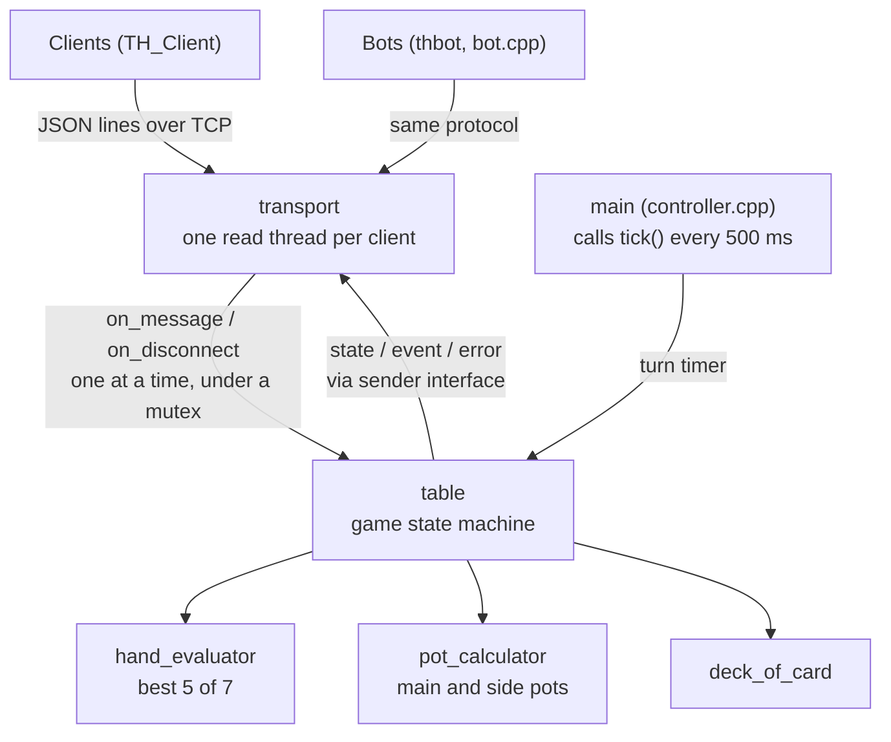

# Texas Hold’em Server 🂡🂮🂱

[](https://github.com/Bryan438/Texas_Holdem_1/actions/workflows/ci.yml)

> **Author:** Bryan  
> **Language:** C++17  
> **Status:** 🛠 Alpha – playable, under refactor  
> **Repos:**  
> • Server (this repo)  
> • Client → https://github.com/Bryan438/TH_Client  


---

## Project Goal
A lightweight, headless Texas Hold’em engine that **accepts socket connections from multiple CLI/GUI clients**, enforces game flow, and sends every player the full game state after each change.

---

## Architecture Overview


---

## Build & Run
```bash
make                      # builds ./thserver, ./thstats, ./thbot and ./thmatch
./thserver                # port 4000, 5 min per turn, 200 chips, blinds 1/2; type s to start each hand
./thserver --port 4000 --turn 60 --chips 500 --next-hand 10
./thserver --turn 0       # no time limit
./thserver --next-hand 10 # optional: start the next hand by itself 10 s after the last one
./thserver --history game.jsonl     # save hands to game.jsonl (default hands.jsonl)
./thserver --no-history   # do not save hands
./thserver --verbose      # also print every message sent and received
./thserver --help
```
Players connect with the client: https://github.com/Bryan438/TH_Client

## Protocol
Newline-delimited JSON over TCP: one JSON object per line, both directions.
You can even play by hand with `nc localhost 4000`.

Client -> server
```jsonc
{"type":"join","name":"Bryan"}
{"type":"join","name":"Bryan","token":"..."}   // take your seat back after a disconnect
{"type":"start"}
{"type":"action","action":"fold"}          // also "check", "call"
{"type":"action","action":"raise","amount":20}   // raise TO 20 this round
```

Server -> client
- `welcome` - your seat number and a secret `token` (keep it to reconnect)
- `state` - the whole table as you may see it, sent to everyone after every change:
  stage, board, pot, current bet, dealer and blinds, every seat's stack / bet / status,
  your own hole cards (everyone's still in the hand at showdown), your best hand,
  whose turn it is and seconds left, seconds until the next hand starts, and, on your turn,
  the allowed actions with the raise range
- `event` - a line for the game log ("Bob raises to 20", "Flop: Q♥ 8♥ 4♠")
- `error` - why a message was rejected
- `hand_summary` - the hand that just ended: actions by street, board, showdown, winners;
  hole cards only for yourself and for hands shown at showdown

Rules handled by the server: turn order, check/call/raise options, minimum raise (a short
all-in does not reopen betting), side pots, heads-up blinds, button rotation. A player who
runs out of time checks if possible, otherwise folds. A player who disconnects folds the
current hand and gets their seat and chips back by joining again with the same name and
their token; without the token nobody else can take that seat. Each hand starts when a player
sends `start`; with `--next-hand N` the next one starts by itself after N seconds instead.

## Hand history and stats
Every finished hand is appended to `hands.jsonl`, one JSON object per line: start stacks,
every player's hole cards, blinds and actions with the street and chips put in (plus
`reason` for timeouts and disconnects), board, showdown, winners, and each player's net.
**The file contains everyone's cards**: it stays on the server and is never sent to players.

```bash
./thstats                 # reads hands.jsonl
./thstats game.jsonl
```
```
Player            Hands      Net   VPIP    PFR    Won  Showdowns     Best
Bob                   2      +11     0%     0%    50%        1/1       24
Alice                 2      -11    50%     0%    50%        0/1        3
```
VPIP: put money in preflop by choice (blinds don't count). PFR: raised preflop.
`thstats` also checks that every hand adds up (chips in = pot = chips out) and warns if not.

## Bots
A bot is a normal player: `thbot` connects over TCP, joins with a name and plays with the
same JSON messages as the client. It decides only from the `state` it is sent, so it sees
what a person in its seat would see, no more. The server does not need to know about bots.

```bash
./thbot                                   # one bot named Robo joins 127.0.0.1:4000
./thbot 192.168.1.20 4000 --bots 3        # Robo1, Robo2, Robo3
./thbot --name Station --style calling --delay 0.5
./thbot --bots 3 --start                  # bots-only table: a bot starts each hand
```
By default a bot never starts a hand, so a person still types `s`. With `--start`, the
first bot starts the next hand a few seconds after the last one ends.

Styles (`bot.cpp`):
- `random` - any legal move; a baseline
- `calling` - always checks or calls, never folds or raises (a "calling station")
- `rules` - preflop: the [Chen formula](https://en.wikipedia.org/wiki/Texas_hold_%27em_starting_hands)
  scores the two hole cards; strong hands raise, middling ones call small raises, the rest fold.
  After the flop: reads its hand (set or better, top pair / overpair, a weaker pair, a flush
  or straight draw with its outs, or nothing). It bets strong hands, calls when the pot odds
  are good enough (rule of 4 and 2 for draws), semi-bluffs some draws, bluffs a little
  heads-up, and folds the rest.

### How strong is each bot?
`thmatch` seats bots on a real table in one process (no network) and plays many hands.
Every bot starts every hand at 100 big blinds, so nobody busts and each hand counts the same.
The same `--seed` gives the same cards and the same result.

```bash
./thmatch --hands 10000 rules calling
./thmatch --hands 5000 rules rules calling random --history bots.jsonl   # then ./thstats bots.jsonl
```
Heads-up, 10,000 hands each (big blinds won per 100 hands, 95% confidence interval):

| Match | Winner | bb/100 |
|---|---|---|
| rules vs calling | rules | +105.7 ± 10.4 |
| rules vs random | rules | +85.3 ± 19.9 |
| calling vs random | too close to tell | 7.0 ± 62.7 |

## Test
```bash
make test       # builds and runs tests/run_tests with AddressSanitizer + UBSan
```
GitHub Actions runs the build and the tests on Linux and macOS for every push and pull request.

Tests have no external dependencies (`tests/test_framework.h`). They cover:
- hand ranking (`hand_evaluator.cpp`): every category, kickers, wheel straight, best 5 of 7
- pot splitting (`pot_calculator.cpp`): main pot, multiple side pots, uncalled bets, odd chips
- line framing (`line_buffer.h`, `transport.cpp`) across split / merged TCP reads
- full hands driven through `table::on_message` with a fake clock: state reaching every
  player after every action, private hole cards, minimum raises, all-ins, turn timer,
  disconnect and reconnect (with and without the token), the next-hand countdown,
  late joiners, busted players
- hand history: what is recorded, what each player is sent, the history file, stats, and
  40 hands of random folds / calls / raises / all-ins that must all add up
- bots: card codes, Chen scores, hand reading (made hands, draws and outs), the moves the
  rules bot picks in set spots, raises kept inside the allowed range, whole matches where every
  move must be legal and every hand add up, same seed same result, and the rules bot beating
  both baselines

JSON: [nlohmann/json](https://github.com/nlohmann/json) v3.11.3, vendored in `third_party/` (MIT).
